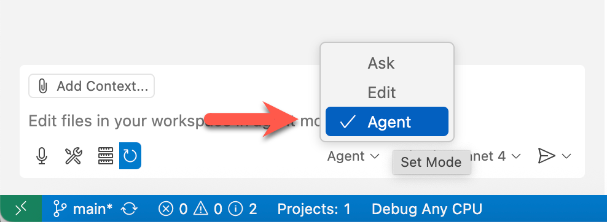

# 02: MCPサーバー

このステップでは、To-Doリスト管理用のMCPサーバーを構築します。

## 前提条件

準備については[README](../README.md#前提条件)ドキュメントを参照してください。

## はじめに

- [GitHub Copilotエージェントモードを確認](#github-copilotエージェントモードを確認)
- [カスタム指示を準備](#カスタム指示を準備)
- [MCPサーバー開発を準備](#mcpサーバー開発を準備)
- [To-Doリスト管理ロジックを開発](#to-doリスト管理ロジックを開発)
- [APIロジックを削除](#apiロジックを削除)
- [MCPサーバーに変換](#mcpサーバーに変換)
- [MCPサーバーを実行](#mcpサーバーを実行)
- [MCPサーバーをテスト](#mcpサーバーをテスト)

## GitHub Copilotエージェントモードを確認

1. GitHub CodespaceまたはVS Codeの上部にあるGitHub Copilotアイコンをクリックして、GitHub Copilotウィンドウを開きます。

   

1. ログインまたはサインアップを求められた場合は、そうしてください。無料です。
1. GitHub Copilotエージェントモードを使用していることを確認してください。

   

1. モデルを`GPT-4.1`または`Claude Sonnet 4`に選択してください。
1. [MCPサーバー](./00-setup.md#mcpサーバーをセットアップ)を設定していることを確認してください。

## MCPサーバーを起動 &ndash; Awesome Copilot

1. Windowsでは`F1`または`Ctrl`+`Shift`+`P`、Mac OSでは`Cmd`+`Shift`+`P`を入力してコマンドパレットを開き、`MCP: List Servers`を検索します。
1. `github`と`monkeymcp` MCPサーバーがまだ実行中の場合は、両方とも停止します。
1. `awesome-copilot`を選択し、`Start Server`をクリックします。

## Beast モードを設定

1. 以下のプロンプトを入力して、beast モードプロンプトを検索します。

    ```text
    Show me the list of copilot instructions for beast chatmode. It should be general purpose.
    ```

   `4.1 Beast Chat Mode`のような結果が返されるはずです。そうでない場合は、再度検索してください。

1. 以下のプロンプトを入力して、beast チャットモードを保存します。

    ```text
    Save it under the `.github/chatmodes` directory.
    ```

1. `Agent`モードの代わりに`4.1-Beast`モードを選択してください。自動的にLLMが`GPT 4.1`に変更されます。

1. 環境変数`$REPOSITORY_ROOT`を設定します。

   ```bash
   # bash/zsh
   REPOSITORY_ROOT=$(git rev-parse --show-toplevel)
   ```

   ```powershell
   # PowerShell
   $REPOSITORY_ROOT = git rev-parse --show-toplevel
   ```

1. ワークスペース設定をコピーします。

    ```bash
    # bash/zsh
    cp $REPOSITORY_ROOT/docs/.vscode/settings.json \
       $REPOSITORY_ROOT/.vscode/settings.json
    ```

    ```powershell
    # PowerShell
    Copy-Item -Path $REPOSITORY_ROOT/docs/.vscode/settings.json `
              -Destination $REPOSITORY_ROOT/.vscode/settings.json -Force
    ```

## カスタム指示を準備

1. 環境変数`$REPOSITORY_ROOT`を設定します。

   ```bash
   # bash/zsh
   REPOSITORY_ROOT=$(git rev-parse --show-toplevel)
   ```

   ```powershell
   # PowerShell
   $REPOSITORY_ROOT = git rev-parse --show-toplevel
   ```

1. カスタム指示をコピーします。

    ```bash
    # bash/zsh
    cp $REPOSITORY_ROOT/docs/.github/todoapp-instructions.md \
       $REPOSITORY_ROOT/.github/copilot-instructions.md
    ```

    ```powershell
    # PowerShell
    Copy-Item -Path $REPOSITORY_ROOT/docs/.github/todoapp-instructions.md `
              -Destination $REPOSITORY_ROOT/.github/copilot-instructions.md -Force
    ```

## MCPサーバー開発を準備

`start`ディレクトリには、ASP.NET Core Minimal APIアプリがすでにスキャフォールドされています。これを出発点として使用します。

1. 環境変数`$REPOSITORY_ROOT`があることを確認してください。

   ```bash
   # bash/zsh
   REPOSITORY_ROOT=$(git rev-parse --show-toplevel)
   ```

   ```powershell
   # PowerShell
   $REPOSITORY_ROOT = git rev-parse --show-toplevel
   ```

1. スキャフォールドされたアプリを`start`から`workshop`にコピーします。

    ```bash
    # bash/zsh
    mkdir -p $REPOSITORY_ROOT/workshop
    cp -r $REPOSITORY_ROOT/start/. \
          $REPOSITORY_ROOT/workshop/
    ```

    ```powershell
    # PowerShell
    New-Item -Type Directory -Path $REPOSITORY_ROOT/workshop -Force
    Copy-Item -Path $REPOSITORY_ROOT/start/* `
              -Destination $REPOSITORY_ROOT/workshop/ -Recurse -Force
    ```

## To-Doリスト管理ロジックを開発

1. `Claude Sonnet 4`または`GPT-4.1`モデルでGitHub Copilotエージェントモードを使用していることを確認してください。
1. `microsoft.docs.mcp`と`sequentialthinking` MCPサーバーが両方とも稼働していることを確認してください。
1. 以下のようなプロンプトを使用してTo-Doリスト管理ロジックを実装します。

    ```text
    ASP.NET Core Minimal APIアプリケーションでTo-Doリスト管理ロジックを実装したいと思います。アプリケーション開発のために以下の指示に従ってください。
    
    - context7を使用してください。
    - 最初に実行する全てのステップを特定してください。
    - 作業ディレクトリは`workshop/src/McpTodoServer.ContainerApp`です。
    - データベースとしてSQLiteを使用し、インメモリ機能を使用する必要があります。
    - データベーストランザクションにEntityFramework Coreを使用してください。
    - アプリケーション開始時にデータベースを初期化してください。
    - To-Doアイテムには`ID`、`Text`、`IsCompleted`カラムのみが含まれます。
    - To-Doリスト管理には5つの機能があります - 作成、リスト、更新、完了、削除。
    - 必要に応じて、.NET 9と互換性のあるNuGetパッケージを追加してください。
    - To-Doリスト管理のAPIエンドポイントは実装しないでください。
    - 初期データは追加しないでください。
    - `complete`ディレクトリを参照しないでください。
    - `start`ディレクトリを参照しないでください。
    ```

1. GitHub Copilotのボタンをクリックして変更を適用します。
1. 以下のようなプロンプトを使用して開発結果を確認します。

    ```text
    アプリケーションをビルドしたいと思います。指示に従ってください。

    - context7を使用してください。
    - アプリケーションをビルドし、正しくビルドされるかどうかを確認してください。
    - ビルドが失敗した場合は、問題を分析して修正してください。
    ```

   > **注**:
   >
   > - ビルドが成功するまでこのステップを繰り返してください。
   > - ビルドが失敗し続ける場合は、エラーメッセージを確認してGitHub Copilot Agentに解決を依頼してください。

1. GitHub Copilotのボタンをクリックして変更を適用します。
1. 以下のようなプロンプトを使用して開発結果を確認します。

    ```text
    アプリケーションに`TodoTool`クラスを追加したいと思います。指示に従ってください。

    - context7を使用してください。
    - 最初に実行する全てのステップを特定してください。
    - 作業ディレクトリは`workshop/src/McpTodoServer.ContainerApp`です。
    - `TodoTool`クラスには5つのメソッドが含まれている必要があります - 作成、一覧表示、更新、完了、削除。
    - 依存関係を登録しないでください。
    ```

## APIロジックを削除

1. `$REPOSITORY_ROOT` 環境変数を設定していることを確認してください。

   ```bash
   # bash/zsh
   REPOSITORY_ROOT=$(git rev-parse --show-toplevel)
   ```

   ```powershell
   # PowerShell
   $REPOSITORY_ROOT = git rev-parse --show-toplevel
   ```

1. アプリケーションプロジェクトに移動します。

    ```bash
    cd $REPOSITORY_ROOT/workshop/src/McpTodoServer.ContainerApp
    ```

1. `Program.cs` を開いて以下をすべて削除します：

   ```csharp
   // 👇👇👇 削除 👇👇👇
   // Add services to the container.
   // Learn more about configuring OpenAPI at https://aka.ms/aspnet/openapi
   builder.Services.AddOpenApi();
   // 👆👆👆 削除 👆👆👆
   ```

   ```csharp
   // 👇👇👇 削除 👇👇👇
   // Configure the HTTP request pipeline.
   if (app.Environment.IsDevelopment())
   {
       app.MapOpenApi();
   }
   // 👆👆👆 削除 👆👆👆
   ```

   ```csharp
   // 👇👇👇 削除 👇👇👇
   var summaries = new[]
   {
       "Freezing", "Bracing", "Chilly", "Cool", "Mild", "Warm", "Balmy", "Hot", "Sweltering", "Scorching"
   };
   // 👆👆👆 削除 👆👆👆
   ```

   ```csharp
   // 👇👇👇 削除 👇👇👇
   app.MapGet("/weatherforecast", () =>
   {
       var forecast =  Enumerable.Range(1, 5).Select(index =>
           new WeatherForecast
           (
               DateOnly.FromDateTime(DateTime.Now.AddDays(index)),
               Random.Shared.Next(-20, 55),
               summaries[Random.Shared.Next(summaries.Length)]
           ))
           .ToArray();
       return forecast;
   })
   .WithName("GetWeatherForecast");
   // 👆👆👆 削除 👆👆👆
   ```

   ```csharp
   // 👇👇👇 削除 👇👇👇
   record WeatherForecast(DateOnly Date, int TemperatureC, string? Summary)
   {
       public int TemperatureF => 32 + (int)(TemperatureC / 0.5556);
   }
   // 👆👆👆 削除 👆👆👆
   ```

1. NuGetパッケージを削除します。

    ```bash
    dotnet remove package Microsoft.AspNetCore.OpenApi
    ```

## MCPサーバーに変換

1. MCPサーバー用のNuGetパッケージを追加します。

    ```bash
    dotnet add package ModelContextProtocol.AspNetCore --prerelease
    ```

1. `Program.cs` を開き、`var app = builder.Build();` を見つけて、その行の直前に以下のコードスニペットを追加します：

    ```csharp
    // 👇👇👇 追加 👇👇👇
    builder.Services.AddMcpServer()
                    .WithHttpTransport(o => o.Stateless = true)
                    .WithToolsFromAssembly();
    // 👆👆👆 追加 👆👆👆
    
    var app = builder.Build();
    ```

1. 同じ `Program.cs` で、`app.Run();` を見つけて、その行の直前に以下のコードスニペットを追加します：

    ```csharp
    // 👇👇👇 追加 👇👇👇
    app.MapMcp("/mcp");
    // 👆👆👆 追加 👆👆👆
    
    app.Run();
    ```

1. `TodoTool.cs` を開いて以下のようにデコレーターを追加します。

   > **注意**：メソッド名はGitHub Copilotによる生成方法によって異なる場合があります。

    ```csharp
    // 👇👇👇 追加 👇👇👇
    [McpServerToolType]
    // 👆👆👆 追加 👆👆👆
    public class TodoTool
    
    ...
    
        // 👇👇👇 追加 👇👇👇
        [McpServerTool(Name = "add_todo_item", Title = "Add a to-do item")]
        [Description("Adds a to-do item to database.")]
        // 👆👆👆 追加 👆👆👆
        public async Task<TodoItem> CreateAsync(string text)
    
    ...
    
        // 👇👇👇 追加 👇👇👇
        [McpServerTool(Name = "get_todo_items", Title = "Get a list of to-do items")]
        [Description("Gets a list of to-do items from database.")]
        // 👆👆👆 追加 👆👆👆
        public async Task<List<TodoItem>> ListAsync()
    
    ...
    
        // 👇👇👇 追加 👇👇👇
        [McpServerTool(Name = "update_todo_item", Title = "Update a to-do item")]
        [Description("Updates a to-do item in the database.")]
        // 👆👆👆 追加 👆👆👆
        public async Task<TodoItem?> UpdateAsync(int id, string text)
    
    ...
    
        // 👇👇👇 追加 👇👇👇
        [McpServerTool(Name = "complete_todo_item", Title = "Complete a to-do item")]
        [Description("Completes a to-do item in the database.")]
        // 👆👆👆 追加 👆👆👆
        public async Task<TodoItem?> CompleteAsync(int id)
    
    ...
    
        // 👇👇👇 追加 👇👇👇
        [McpServerTool(Name = "delete_todo_item", Title = "Delete a to-do item")]
        [Description("Deletes a to-do item from the database.")]
        // 👆👆👆 追加 👆👆👆
        public async Task<bool> DeleteAsync(int id)
    
    ...
    ```

1. 同じ `TodoTool.cs` で、追加の `using` ディレクティブを追加します：

   > **注意**：名前空間はGitHub Copilotによる生成方法によって異なる場合があります。

    ```csharp
    // 👇👇👇 追加 👇👇👇
    using ModelContextProtocol.Server;
    using System.ComponentModel;
    // 👆👆👆 追加 👆👆👆
    
    namespace McpTodoServer.ContainerApp.Tools;
    ```

1. アプリケーションをビルドします。

    ```bash
    dotnet build
    ```

## MCPサーバーを実行

1. `$REPOSITORY_ROOT` 環境変数を設定していることを確認してください。

   ```bash
   # bash/zsh
   REPOSITORY_ROOT=$(git rev-parse --show-toplevel)
   ```

   ```powershell
   # PowerShell
   $REPOSITORY_ROOT = git rev-parse --show-toplevel
   ```

1. アプリケーションプロジェクトに移動します。

    ```bash
    cd $REPOSITORY_ROOT/workshop/src/McpTodoServer.ContainerApp
    ```

1. MCPサーバーアプリケーションを実行します。

    ```bash
    dotnet run
    ```

1. `F1` を押すか、Windowsでは `Ctrl`+`Shift`+`P`、Mac OSでは `Cmd`+`Shift`+`P` を押してコマンドパレットを開き、`MCP: Add Server...` を検索します。
1. `HTTP (HTTP or Server-Sent Events)` を選択します。
1. サーバーURLとして `http://localhost:5242/mcp` を入力します。
1. サーバーIDとして `mcp-todo` を入力します。
1. MCP設定を保存する場所として `Workspace settings` を選択します。
1. `.vscode/mcp.json` を開いて、MCPサーバーが追加されたことを確認します。

    ```jsonc
    {
      "servers": {
        "context7": {
          "command": "npx",
          "args": [
            "-y",
            "@upstash/context7-mcp"
          ]
        },
        // 👇👇👇 追加済み 👇👇👇
        "mcp-todo": {
            "url": "http://localhost:5242/mcp"
        }
        // 👆👆👆 追加済み 👆👆👆
      }
    }
    ```

## MCPサーバーをテスト

1. GitHub Copilot Chatをエージェントモードで開きます。
1. 以下のプロンプトのいずれかを入力します：

    ```text
    To-Doリストを表示してください。
    "12時にランチ"を追加してください。
    ランチを完了としてマークしてください。
    "午後3時に会議"を追加してください。
    会議を午後3時30分に変更してください。
    会議をキャンセルしてください。
    ```

1. エラーが発生した場合は、GitHub Copilotに修正を依頼してください：

    ```text
    "xxx"というエラーが発生しました。問題を見つけて修正してください。
    ```

---

完了しました。「MCPサーバー開発」ステップを完了しました。次は[ステップ02：MCPリモートサーバー](./02-mcp-remote-server.md)に進みましょう。

---

このドキュメントは[GitHub Copilot](https://docs.github.com/copilot/about-github-copilot/what-is-github-copilot)によってローカライズされました。そのため、誤りが含まれる可能性があります。不適切または間違った翻訳を見つけた場合は、[issue](../../../../../issues)を作成してください。